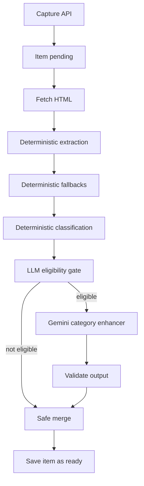

# Gemini Category Enrichment Implementation Plan

> **For agentic workers:** REQUIRED SUB-SKILL: Use superpowers:subagent-driven-development (recommended) or superpowers:executing-plans to implement this plan task-by-task. Steps use checkbox (`- [ ]`) syntax for tracking.

**Goal:** Improve category-specific enrichment for saved links by using Gemini as a server-side normalization layer after Theque's deterministic extraction and classification.

**Architecture:** Keep the current deterministic pipeline as the source of truth for URL fetching, parser extraction, and category classification. Add a gated Gemini enhancement step after classification that returns validated, category-specific fields, then merge those fields conservatively into `structured`, top-level display fields, and `raw_metadata.llm`.

**Tech Stack:** Next.js 16 App Router, TypeScript, Supabase Postgres, existing enrichment jobs, Vitest, Gemini API through AI Studio API key, optionally Vercel AI SDK or direct Gemini SDK after verifying current structured-output support.

---

## Product Decision Summary

- Use Gemini only for v1. Perplexity Pro web access should not be automated from the app backend.
- Keep Perplexity as a future provider slot only if/when API billing is acceptable.
- Preserve deterministic classification from `src/lib/classify/index.ts`.
- Gemini may enrich fields for the already-classified category, but must not change `category`, `category_source`, or `category_confidence` in v1.
- Gemini should run server-side only and fail open: if the model call fails, the deterministic enrichment result should still be saved.
- Prefer conservative merging: fill missing or weak data, avoid overwriting strong deterministic values.

---

## Existing Pipeline Context

The current flow is:

```text
/api/capture
-> insert items row with processing_status = pending
-> after(() => enrichItem(id))
-> fetchPage(canonical_url)
-> extractFromHtml(html)
-> applyEnrichmentFallbacks(...)
-> classify(...)
-> build title/subtitle/status/display
-> update items row as ready
```

Key files:

- `src/app/api/capture/route.ts`: creates items and triggers `enrichItem`.
- `src/app/api/jobs/enrich/route.ts`: cron/manual batch enrichment endpoint.
- `src/app/api/items/[id]/retry-enrichment/route.ts`: retry path.
- `src/lib/jobs/enrich-item.ts`: main orchestration point.
- `src/lib/enrichment/extract.ts`: OG/Twitter/JSON-LD/domain parser extraction.
- `src/lib/enrichment/apply-fallbacks.ts`: deterministic fallback hook.
- `src/lib/classify/index.ts`: deterministic category classification.
- `docs/category-schemas.md`: current category field expectations.
- `docs/data-model.md`: `items.structured`, `items.raw_metadata`, and category enum docs.

Target future flow:



---

## File Structure

- Create `src/lib/enrichment/llm/category-schemas.ts`: runtime schemas and TypeScript types for category-specific Gemini output.
- Create `src/lib/enrichment/llm/gemini-category-enhancer.ts`: server-only Gemini call, prompt construction, timeout/error handling, and typed result.
- Create `src/lib/enrichment/llm/merge-llm-enrichment.ts`: deterministic merge rules for top-level fields, `structured`, and `raw_metadata.llm`.
- Create `src/lib/enrichment/llm/eligibility.ts`: rules for deciding whether Gemini should run.
- Modify `src/lib/jobs/enrich-item.ts`: call the eligibility gate and Gemini enhancer after classification, then merge before the database update.
- Modify `.env.local.example`: document `GEMINI_API_KEY` and `LLM_ENRICHMENT_ENABLED`.
- Optionally modify `docs/category-schemas.md`: document `raw_metadata.llm` and LLM merge behavior.
- Add tests under `src/lib/enrichment/llm/*.test.ts`.

---

## Task 1: Decide SDK And Provider Boundary

**Files:**
- Inspect: `package.json`
- Inspect: current Gemini structured-output docs
- No repo changes required until the decision is made

- [ ] **Step 1: Verify current SDK support**

Check current documentation before implementation:

```text
Vercel AI SDK structured output with Gemini
Gemini API structured output with JSON schema
Gemini model IDs available for API-key usage
```

Expected: confirm whether Vercel AI SDK can reliably call Gemini with structured output for this use case, or whether direct Gemini SDK/API is simpler.

- [ ] **Step 2: Choose one provider implementation**

Recommended default:

```text
Use direct Gemini API or official Google SDK if Vercel AI SDK structured output has Gemini limitations.
Use Vercel AI SDK only if current docs confirm stable Gemini structured output for the selected model.
```

Expected: one provider boundary in `gemini-category-enhancer.ts`, not provider-specific logic spread through `enrich-item.ts`.

- [ ] **Step 3: Add dependency if needed**

Use `npm install` with the selected package only after choosing:

```bash
npm install <selected-gemini-or-ai-sdk-package>
```

Expected: `package.json` and `package-lock.json` update only with required dependencies.

---

## Task 2: Define Category Output Contracts

**Files:**
- Create: `src/lib/enrichment/llm/category-schemas.ts`
- Test: `src/lib/enrichment/llm/category-schemas.test.ts`
- Reference: `docs/category-schemas.md`

- [ ] **Step 1: Write schema tests**

Add tests that validate accepted and rejected field shapes:

```ts
import { describe, expect, it } from "vitest";

import { validateLlmCategoryFields } from "@/lib/enrichment/llm/category-schemas";

describe("validateLlmCategoryFields", () => {
  it("accepts movie fields for movies_and_tv", () => {
    const result = validateLlmCategoryFields("movies_and_tv", {
      title: "Inception",
      subtitle: "Christopher Nolan · 2010",
      description: "A thief enters dreams to steal secrets.",
      structured: {
        year: 2010,
        directors: ["Christopher Nolan"],
        runtime_minutes: 148,
        genres: ["Action", "Sci-Fi"],
        media_type: "movie",
      },
      confidence: 0.84,
      sources: ["existing page metadata"],
    });

    expect(result.ok).toBe(true);
  });

  it("rejects unknown structured fields", () => {
    const result = validateLlmCategoryFields("books", {
      structured: { directors: ["Wrong category"] },
      confidence: 0.7,
      sources: ["model"],
    });

    expect(result.ok).toBe(false);
  });
});
```

Expected: tests fail until schemas exist.

- [ ] **Step 2: Implement category schemas**

Define a small internal schema layer without overbuilding. If no schema library is already present, use hand-written validators rather than adding a dependency only for this.

Core output shape:

```ts
export type LlmCategoryEnhancement = {
  title?: string;
  subtitle?: string;
  description?: string;
  image_url?: string;
  structured?: Record<string, unknown>;
  confidence: number;
  sources: string[];
  notes?: string;
};
```

Expected: validation allows only documented fields for the deterministic category.

- [ ] **Step 3: Run focused tests**

```bash
npm test -- src/lib/enrichment/llm/category-schemas.test.ts
```

Expected: schema tests pass.

---

## Task 3: Add Eligibility Gate

**Files:**
- Create: `src/lib/enrichment/llm/eligibility.ts`
- Test: `src/lib/enrichment/llm/eligibility.test.ts`

- [ ] **Step 1: Write eligibility tests**

Cover these cases:

```text
disabled when LLM_ENRICHMENT_ENABLED is not true
disabled when GEMINI_API_KEY is missing
enabled when category-specific fields are sparse
enabled when fetch appears blocked or title is weak
disabled when deterministic data is already strong enough
disabled for manual category only if the structured data is already strong
```

Expected: tests fail until eligibility logic exists.

- [ ] **Step 2: Implement eligibility**

Recommended rules:

```text
Run Gemini only when:
- LLM_ENRICHMENT_ENABLED=true
- GEMINI_API_KEY is present
- item has a deterministic category
- at least one important field for that category is missing or weak

Do not run Gemini only because the item exists.
```

Expected: the model is called selectively, keeping cost and latency bounded.

- [ ] **Step 3: Run focused tests**

```bash
npm test -- src/lib/enrichment/llm/eligibility.test.ts
```

Expected: eligibility tests pass.

---

## Task 4: Implement Gemini Category Enhancer

**Files:**
- Create: `src/lib/enrichment/llm/gemini-category-enhancer.ts`
- Test: `src/lib/enrichment/llm/gemini-category-enhancer.test.ts`

- [ ] **Step 1: Write mocked provider tests**

Test that the enhancer:

```text
builds a prompt with final URL, category, existing fields, and metadata evidence
requests only the deterministic category schema
validates returned JSON before exposing it to callers
returns a skipped or failed result without throwing on model errors
does not include user secrets or service-role credentials in prompts
```

Expected: tests fail until enhancer exists.

- [ ] **Step 2: Implement server-only enhancer**

Design the public function around app data, not provider internals:

```ts
export async function enhanceCategoryWithGemini(input: {
  finalUrl: string;
  category: ItemCategory;
  title: string | null;
  subtitle: string | null;
  description: string | null;
  image_url: string | null;
  structured: Record<string, unknown>;
  rawMetadata: RawMetadata;
}): Promise<
  | { status: "enhanced"; enhancement: LlmCategoryEnhancement; providerMetadata: Record<string, unknown> }
  | { status: "skipped"; reason: string }
  | { status: "failed"; reason: string }
>;
```

Expected: provider errors are contained inside this module.

- [ ] **Step 3: Prompt Gemini for normalization, not browsing**

Prompt intent:

```text
You are normalizing metadata for a private visual bookmark library.
Use only the provided URL and metadata evidence.
The deterministic category is fixed and must not be changed.
Return only fields allowed by the schema.
Use null or omit fields when evidence is insufficient.
Do not invent prices, ratings, authors, or release years.
```

Expected: v1 does not ask Gemini to perform web search. Perplexity/web-search context can be added later as an extra evidence source.

- [ ] **Step 4: Run focused tests**

```bash
npm test -- src/lib/enrichment/llm/gemini-category-enhancer.test.ts
```

Expected: mocked provider tests pass without real API calls.

---

## Task 5: Implement Safe Merge

**Files:**
- Create: `src/lib/enrichment/llm/merge-llm-enrichment.ts`
- Test: `src/lib/enrichment/llm/merge-llm-enrichment.test.ts`

- [ ] **Step 1: Write merge tests**

Cover:

```text
fills missing structured fields
does not overwrite existing strong structured fields
replaces weak title with Gemini title
does not replace strong title
adds raw_metadata.llm provider details
records failed/skipped LLM attempts without failing enrichment
never changes category fields
```

Expected: tests fail until merge logic exists.

- [ ] **Step 2: Implement merge rules**

Recommended merge policy:

```text
Top-level title: replace only if current title is missing or weak.
Top-level subtitle: replace only if missing.
Description: replace only if missing or obviously weak.
Image URL: replace only if missing.
Structured fields: fill missing fields only.
Raw metadata: append raw_metadata.llm with provider, model, status, confidence, requested category, returned fields, and timestamp.
```

Expected: model output cannot silently degrade deterministic parser output.

- [ ] **Step 3: Run focused tests**

```bash
npm test -- src/lib/enrichment/llm/merge-llm-enrichment.test.ts
```

Expected: merge tests pass.

---

## Task 6: Wire Into `enrichItem`

**Files:**
- Modify: `src/lib/jobs/enrich-item.ts`
- Test: existing enrichment tests plus any new job-level tests if practical

- [ ] **Step 1: Add failing integration-style tests**

Test the orchestration with mocked LLM modules:

```text
when eligible and enhanced, enrichItem writes merged structured fields
when Gemini fails, enrichItem still writes deterministic result and processing_status ready
manual category source is preserved
category_source and category_confidence remain deterministic
```

Expected: tests fail until `enrichItem` is wired.

- [ ] **Step 2: Call eligibility and enhancer after classification**

Place the hook after `classification` and after `structuredClean` is created, before calculating final subtitle/title where possible.

Expected flow inside `enrichItem`:

```text
fetch
extract
classify
prepare structured
maybe Gemini enhance
merge LLM result
build subtitle/title/display/status
update item
```

- [ ] **Step 3: Preserve existing behavior by default**

With `LLM_ENRICHMENT_ENABLED` absent, `enrichItem` should behave like it does today.

Expected: no production behavior changes until the env flag is enabled.

- [ ] **Step 4: Run tests**

```bash
npm test
```

Expected: all Vitest tests pass.

---

## Task 7: Env, Docs, And Rollout

**Files:**
- Modify: `.env.local.example`
- Modify: `docs/category-schemas.md`
- Optionally modify: `docs/api-contract.md`

- [ ] **Step 1: Document env vars**

Add server-only env vars:

```bash
GEMINI_API_KEY=
LLM_ENRICHMENT_ENABLED=false
```

Expected: no `NEXT_PUBLIC_` prefix; key never reaches client code.

- [ ] **Step 2: Document LLM metadata**

Document `raw_metadata.llm` shape:

```json
{
  "provider": "gemini",
  "model": "selected-model-id",
  "status": "enhanced",
  "category": "books",
  "confidence": 0.82,
  "returned_fields": ["authors", "published_year"],
  "sources": ["open_graph", "json_ld"],
  "enriched_at": "ISO8601"
}
```

Expected: future debugging can explain where LLM fields came from.

- [ ] **Step 3: Define rollout**

Recommended rollout:

```text
Local only with LLM_ENRICHMENT_ENABLED=true
Then production disabled by default
Then enable for sparse/blocked pages only
Then broaden category by category after QA
```

Expected: no surprise model cost spike.

- [ ] **Step 4: Run final checks**

```bash
npm test
npm run lint
npm run build
```

Expected: tests, lint, and build pass before marking complete.

---

## Future Perplexity Slot

Do not implement this in v1. Design the Gemini input so a later research provider can add evidence:

```text
deterministic metadata evidence
+ optional search-grounded evidence from Perplexity API
-> Gemini schema normalization
-> same validation and merge path
```

Future provider boundary:

```ts
export type ResearchEvidence = {
  provider: "perplexity";
  query: string;
  snippets: string[];
  citations: string[];
  fetched_at: string;
};
```

Use this only after choosing Perplexity API billing. Do not automate the Perplexity Pro web app.

---

## Self-Review

- Spec coverage: The plan covers the chosen category-enhancer direction, Gemini-only v1, deterministic classification preservation, server-only secrets, conservative merge, testing, and rollout.
- Placeholder scan: No implementation task depends on an unspecified module without defining where it will be created.
- Scope check: This is one coherent subsystem: LLM category enrichment inside the existing enrichment job. A separate Perplexity research stage is intentionally deferred.

