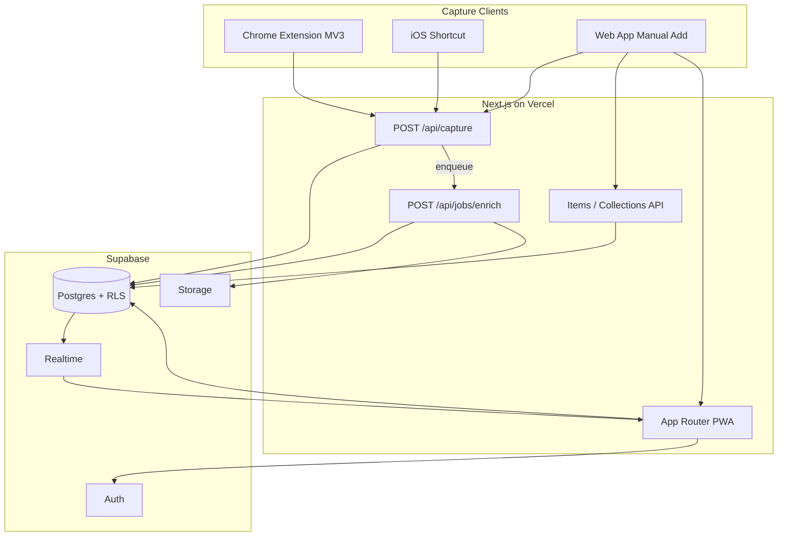

# Keepswell — Design Specification

**Status:** Approved for implementation  
**Date:** 2026-05-15  
**Decisions locked:** Next.js + Supabase; Option A shelves (smart views only)

## Summary

Keepswell is a personal visual library for things discovered while browsing. Capture is one gesture (Chrome extension, iOS Shortcut, paste URL); the backend saves immediately and enriches asynchronously; the UI prioritizes beautiful shelf browsing over inbox administration.

## Goals

See [product-brief.md](../../product-brief.md) for success criteria and non-goals.

## Architecture

### Why async enrichment

Capture path must return in under 500ms. Metadata fetch (8s timeout) and classification run in a background job triggered after insert. UI shows skeleton cards until `processing_status = ready`.

### Auth model

| Surface | Method |
|---------|--------|
| Web | Supabase session (`@supabase/ssr`) |
| Extension / Shortcut | Personal capture token (`Authorization: Bearer bmly_...`) |
| Cron job | `CRON_SECRET` header |

Service role key lives only in server env (`SUPABASE_SERVICE_ROLE_KEY`). Never `NEXT_PUBLIC_`.

### Module boundaries

| Module | Responsibility |
|--------|----------------|
| `src/lib/url/*` | Normalize URL, fingerprint, domain |
| `src/lib/enrichment/*` | Fetch HTML, extract OG/JSON-LD, domain parsers |
| `src/lib/classify/*` | Rules-based category + confidence |
| `src/lib/jobs/enrich-item.ts` | Orchestrate pipeline for one item |
| `src/app/api/*` | HTTP contracts |
| `src/lib/shelves.ts` | Shelf filter definitions |
| `extension/*` | Chrome MV3 popup + background |

## Data model

Full SQL and RLS: [data-model.md](../../data-model.md)

## API

Full contract: [api-contract.md](../../api-contract.md)

## UI

Shelf definitions and UX: [ui-shelves.md](../../ui-shelves.md)

Category JSON shapes: [category-schemas.md](../../category-schemas.md)

## Classification (PoC)

Priority order:

1. **Domain map** — `imdb.com` → `movies_and_tv` (0.95)
2. **schema.org `@type`** — `Book` → `books` (0.85)
3. **Path heuristics** — `/recipe/` → `recipes` (0.7)
4. **Fallback** — `articles` (0.4) → force `status = inbox`

No LLM in PoC.

## Risks and mitigations

| Risk | Mitigation |
|------|------------|
| Scrape blocked | `failed` status + retry; minimal card from URL |
| Maps sparse metadata | Accept thin restaurant cards; Places API later |
| Hotlink broken images | Optional Storage proxy in enrichment |
| RLS misconfiguration | Migration includes policies; test with second user |
| Serverless timeout | Enrichment in cron/job route, not in capture handler |
| Token leak | Revocable tokens; hash-only storage |

## Supabase plugin / MCP

During implementation:

- Use Supabase MCP for `execute_sql`, advisors, and docs search when connected
- Follow `supabase` skill: RLS on all public tables; never use `user_metadata` for auth
- Generate migrations via `supabase migration new` then `supabase db pull` when schema stabilizes

## Out of scope (v0.1)

Native iOS Share Extension, AI classifier, Places API, public sharing, offline mode.

## Document index

| Doc | Purpose |
|-----|---------|
| [product-brief.md](../../product-brief.md) | Why and what |
| [data-model.md](../../data-model.md) | Schema + RLS |
| [api-contract.md](../../api-contract.md) | HTTP API |
| [category-schemas.md](../../category-schemas.md) | JSONB shapes |
| [ui-shelves.md](../../ui-shelves.md) | Shelf filters + UX |
| [plans/2026-05-15-keepswell.md](../plans/2026-05-15-keepswell.md) | Implementation tasks |
